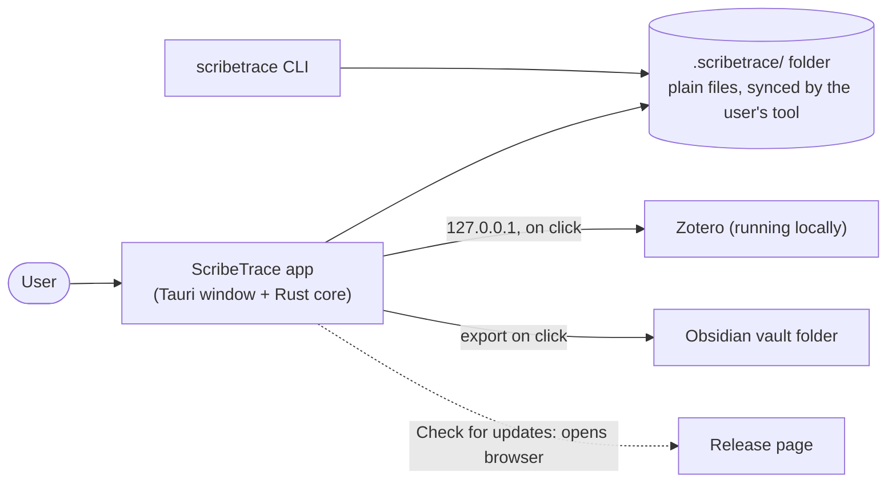

# ScribeTrace: Architecture (v3.0, lean)

**Date:** 2026-11-05 · **Platforms:** Linux, Windows 10+, macOS 12+ · **License:** Apache-2.0 (assumed)  
**Rule for this file:** nothing stays without a user-visible need or a security item behind it; everything else is in "Later" with a trigger. Details live in the ADRs; spikes in [PROTOTYPE-PLAN](PROTOTYPE-PLAN.md). Old requirement IDs (F1–F7) are being renumbered by pm, so this file traces **capabilities**.

## 1. Goal and constraints
ScribeTrace keeps the **history** of how your reading marks and notes change, as a companion to Zotero and Obsidian, not a replacement. Fixed by the user: desktop; PDF + Markdown only (EPUB/HTML later); open format; local `.scribetrace/` folder; open source; **lightweight is a selling point**.
Constraints: sources are never modified; plain files readable without the app; one network destination (Zotero on this computer); small team, so boring mainstream tools.

## 2. Context

## 3. Layers (clean architecture) and the dependency rule
| Layer | Contains | Crate / folder |
|---|---|---|
| **Domain** | Events, union merge, purge visibility, milestones, note revisions. Pure functions: no I/O, no clock | `scribetrace-core::domain` |
| **Application** | Use cases: import/refresh, open paper, save note, restore, forget, export. Defines the ports (traits) it needs | `scribetrace-core::app` |
| **Adapters** | Log files, device store, Zotero broker (HTTP), exporter, (Stage 2) PDF anchoring. Implement the ports | `scribetrace-core::adapters`, `scribetrace-zotero` |
| **UI** | Tauri shell + React window; CLI. Reach use cases only through typed, allow-listed commands | `app/`, `scribetrace-cli` |

**Dependency rule:** source code points inward only: UI and adapters → application → domain. The domain imports nothing; the window has no file, socket or OS access. *Why:* every rule is testable without a window, a disk or Zotero, and the CLI reuses the same core.
Shared: `scribetrace-format` (types, validators, `spec/` vectors); `tests/fixtures/zotero/` holds recorded Zotero answers.

## 4. Key decisions
| # | Decision | Reason | ADR |
|---|---|---|---|
| 1 | Two stages: history recorder first, own reader after a product gate | The reader is the costliest part and is not needed to show history | [0006](adr/0006-staged-mvp-and-delivery-shape.md) |
| 2 | Tauri v2 + Rust core, React + Vite UI | Smallest realistic installer and memory; memory-safe core; most common UI library | [0006](adr/0006-staged-mvp-and-delivery-shape.md) |
| 3 | One append-only file per paper **per device**; read = union by id | No two writers, so sync tools cannot conflict; merge is order-independent by construction | [0007](adr/0007-per-device-history-log-merge-and-forget.md) |
| 4 | Forget = delete locally + `purge` event naming the last seq seen per device | Exact and clock-free; honest about sync copies | [0007](adr/0007-per-device-history-log-merge-and-forget.md) |
| 5 | Notes are `note.md` plus full-text revisions; Obsidian gets a one-way export | Readable without the app; no watcher or live mirror | [0008](adr/0008-notes-and-obsidian-export.md) |
| 6 | Zotero via its local interface, through one core-side broker; links are saved with Zotero's Connector, no capture component of our own | No database reading; blocks local-network probing; nothing new to secure | [0009](adr/0009-zotero-integration.md), [0013](adr/0013-links-via-zotero-connector.md) |
| 7 | Published event spec with test vectors, plus a three-command CLI | "Open format" must be checkable without our app | [0010](adr/0010-open-format-spec-and-cli.md) |
| 8 | No updater, no update request: "Check for updates" opens the release page | Fewer network paths, a one-sentence privacy story | [0012](adr/0012-distribution-updates-and-network-rule.md) |

Stage 2 reader (PDF.js, simple anchoring): [0011](adr/0011-reader-pdf-markdown-and-anchoring.md). ADRs 0001–0005 are in [adr/archive/](adr/archive/).

## 5. Security in one screen
Full list: [SECURITY-REQUIREMENTS](SECURITY-REQUIREMENTS.md) (36 items), [THREAT-MODEL](THREAT-MODEL.md). Only the rules that shape components are repeated; each ADR ends with its security line.
- Window: CSP, no sockets, typed commands only (SEC-2, 15, 16). Network: Zotero loopback only (SEC-1, 33).
- Every file line, Zotero answer and Markdown text is untrusted: schema and size check, escape or sanitize on display (SEC-7, 8, 12, 13).
- Paths: workspace, granted read folders and the chosen export folder only; ids and file names validated (SEC-14, 17, 18, 20, 21).
- Source documents opened read-only; PDF parsing in a worker, Stage 2 only (SEC-5, 19).
- Supply chain (lockfiles, audit, signed releases, checksums) is CI process (SEC-25 to 27, 29); website items 30 to 32 are outside the app.
- Privacy: random device id outside the synced folder, author label "Me", no telemetry (SEC-34, 35).
Open request to security: tag each SEC item *enforced in code*, *process* or *deferred*, and reword SEC-1 and SEC-28 for ADR 0012.

## 6. Traceability (capability → component → test)
| Capability | Component | Verified by |
|---|---|---|
| Import / refresh Zotero marks (also the "I have a link" journey) | Zotero broker, use case `import` | Stand-in server tests (recorded cases); live check (SPIKE-3) |
| Append-only history, merge across machines | Log adapter, domain merge | Property tests: any order, merge twice = once (SPIKE-1) |
| Safe against clones, restores, crashes | Device store | Collision-case table tests (SPIKE-1) |
| A corrupt line does not break reading | Validators | Fault injection; files byte-identical after a read |
| Milestones, what changed, restore | Domain, timeline UI | End-to-end journey test |
| Notes with history | Notes use case | Edit / restart / outside-edit tests |
| Obsidian export | Exporter | Golden-file test; marked-file overwrite test |
| Forget history | Domain purge, UI banner | Pure-function test with wrong clocks (SPIKE-2) |
| Open format + CLI | `scribetrace-format`, CLI | Vectors pass in app and CLI |
| Stage 2: own reader and marks | Reader, anchoring | Anchoring corpus (S2-A); 3-OS render (SPIKE-4) |
| Lightness | Whole app | CI size and memory gates (budget below) |

Cross-cutting tests: network-namespace run with zero connections except Zotero loopback; fuzz the line reader; CI on Linux, Windows, macOS.

## Lightness budget
pm's targets from [debate/08](debate/08-links-and-3-step.md) Part C, adopted as the single set. Each is measured, never assumed: SPIKE-4 sets the baseline, then CI fails a build that exceeds a row. Sourced reference figures (Tauri vs Electron vs local web UI) are in [ADR 0006](adr/0006-staged-mvp-and-delivery-shape.md).
| Item | Budget | Check |
|---|---|---|
| Installer size | Stage 1 ≤ 20 MB, Stage 2 ≤ 35 MB per system (Electron's runtime alone is 121 to 158 MB zipped) | CI artifact size |
| Idle memory, window open | Target ≤ 120 MB; gate per OS (empty shell): Linux ≤ 200 MB (amended 2026-11-06), Windows ≤ 140 MB, macOS provisional ≤ 140 MB ([ADR 0014](adr/0014-linux-idle-memory-budget.md)); ≤ 250 MB with a 200-page PDF open (Stage 2) | SPIKE-4, release check |
| Cold start to usable window | ≤ 2 s on 4 cores, 8 GB | SPIKE-4 |
| Paper list / timeline / refresh of 200 marks | ≤ 2 s / ≤ 1 s / ≤ 5 s | Replay and import benchmarks (SPIKE-1, 3) |
| First page of a 50 MB PDF (Stage 2) | ≤ 1.5 s, hard ceiling 2.0 s | SPIKE-4 |
| Background work | 0 background processes, no tray, no auto-start, no watcher, no polling | Process audit |
| Network | 1 destination (127.0.0.1, Zotero), only on click | Network-namespace test |
| Dependencies | ≤ 15 direct Rust crates, ≤ 6 direct JS packages (Stage 1) | Lockfile check in CI |
| History on disk | ≤ 1 MB per paper per year of normal use; ≤ 1 KB per event line | Format vectors |

Journey targets in [debate/08](debate/08-links-and-3-step.md) Part B (first mark imported within 5 minutes of install) are product tests, not architecture budgets.

## 7. Later (each with a trigger)
| Item | Add only when |
|---|---|
| Snapshots / compaction | replaying 10,000 events exceeds 1 s |
| Hash chain over events | a user or auditor asks for tamper evidence |
| File watcher, live Obsidian mirror, import back | users report the on-click export is not enough |
| In-app update check or signed updater | outdated versions are a measured share of issues; a signing routine exists |
| W3C JSON-LD export, CLI `merge` | an outside tool maintainer asks |
| EPUB, HTML, ink, side-by-side diff, group libraries | Stage 2 is adopted and users request them |
| `scribetrace://` links, direct-PDF-URL add, reading-session log | after Stage 2, or if many users lack Zotero (ADR 0013) |

## 8. Review log and simplification log
Reviews: security [APPROVED](reviews/security-architecture-v2.md); v3.0 and ADR 0013 also [APPROVED](reviews/security-note-link-capture.md) (SEC items now tagged code / process / deferred); QA [findings](reviews/qa-architecture-v2.md), all applied (device check, read-only log files, day-1 Zotero gate, purge rule, note conflict rule). Earlier rounds: [debate/07](debate/07-tech-decision-memo.md).
**Simplification log (Round 8):**
- Hybrid logical clock, 24 h future bound, `hlc` purge fallback → `ts` for display only; ordering never changes results (nothing to attack or test).
- `retired_ids`, file size, `purge_answers` in device state → one `last_id` check per paper; a mismatch just mints a new id.
- `corrupt/` diagnostic files → skip and count in UI and `check`; no extra files to sync.
- Peer purge prompt state machine → passive banner with a button; no stored answer.
- Note conflict chooser → last writer wins, both versions kept in history.
- Update manifest with TLS, timeout and downgrade contract → release page opened in the browser.
- Export hash tracking → marker line per generated file. CLI `merge` and W3C export → Later.
- Four extra Mermaid diagrams, the SEC status table, stage table and v2.1 review-log rows → removed; linked files cover them.
- ADRs 0001–0005 → archived (merged or superseded); 7 active ADRs, one page each.
