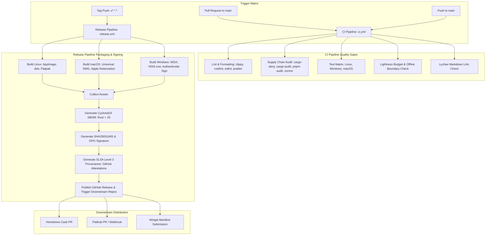

# ScribeTrace: Continuous Integration & Continuous Delivery (CI/CD) Architecture

**Document Version:** 1.0  
**Date:** 2026-11-06  
**Author:** Senior DevOps & Platform Engineer  
**Status:** Approved Engineering Specification  
**Repository Path:** `docs/CI-CD.md`  
**Security Alignment:** Aligned with `docs/SECURITY-REQUIREMENTS.md` (SEC-25 through SEC-29) and `docs/ARCHITECTURE.md` (Section 6 Lightness Budget)

---

## 1. Pipeline Vision & Engineering Principles

ScribeTrace is an open-source, local-first research paper reader built with a Tauri v2 desktop shell, a memory-safe Rust core engine (`scribetrace-core`), and a lightweight React/TypeScript presentation layer.

The continuous integration and continuous delivery (CI/CD) infrastructure serves as the automated enforcement mechanism for ScribeTrace's core architectural and security invariants:
1. **Deterministic & Immutable Builds:** All compilation steps strictly consume cryptographic lockfiles (`Cargo.lock`, `pnpm-lock.yaml`) with `--locked` and `--frozen-lockfile` flags. Dependencies are pinned to exact versions; builds are reproducible bit-for-bit across clean runners.
2. **Least-Privilege Execution (SEC-27):** All GitHub Actions workflows enforce a top-level `permissions: contents: read` baseline. Write permissions (asset publishing, provenance attestation) are isolated to dedicated, single-purpose release jobs protected by GitHub Environment approval gates.
3. **Cryptographic Action Pinning (SEC-27):** Every external GitHub Action is referenced exclusively by its immutable, 40-character commit SHA, paired with an inline comment denoting the semantic tag version.
4. **Comprehensive Supply-Chain Hardening (SEC-25, SEC-26, SEC-29):**
   * Pre-merge automated dependency vulnerability audits (`cargo-audit`, `pnpm audit`) blocking any CVSS score $\ge 7.0$.
   * Generation of complete Software Bill of Materials (SBOM) in CycloneDX JSON format (SEC-26).
   * SLSA Level 3 build provenance attestations via Sigstore/GitHub Artifact Attestations (SEC-29).
   * Detached cryptographic signatures for release checksums (`SHA256SUMS`).
5. **Architectural Budget Enforcement (Architecture §6):** Automated CI gates enforce hard limits on installer sizes, memory footprint baselines, direct crate/package counts ($\le 15$ direct Rust crates, $\le 6$ direct JS packages), and offline network boundaries.

---

## 2. CI/CD Architecture Overview



---

## 3. Pull Request & Continuous Integration Pipeline (`.github/workflows/ci.yml`)

The CI workflow executes on every pull request and push to the `main` branch. It acts as an unyielding gatekeeper, ensuring no code merges without passing rigorous linting, security audits, multi-platform tests, and budget limits.

### 3.1 Quality Gates & Tooling Matrix

| Gate | Purpose | Tooling / Command | Failure Condition |
| :--- | :--- | :--- | :--- |
| **Rust Code Quality** | Enforce idiomatic style and zero compiler warnings | `cargo fmt --check`<br>`cargo clippy --all-targets -- -D warnings` | Any unformatted file or clippy warning |
| **Frontend Code Quality** | Enforce TypeScript safety and formatting | `pnpm prettier --check`<br>`pnpm eslint . --max-warnings=0` | Any syntax, linting, or formatting error |
| **Supply Chain Security** | Block vulnerable or non-compliant dependencies (SEC-25) | `cargo deny check`<br>`cargo audit`<br>`pnpm audit` | Any banned license, unvetted crate, or advisory CVSS $\ge 7.0$ |
| **Workflow Security** | Enforce SHA pinning and least privilege (SEC-27) | `zizmor .github/workflows/*.yml`<br>`actionlint` | Any mutable action tag or unpinned reference |
| **Cross-Platform Tests** | Validate domain logic, adapters, and UI | `cargo nextest run --all-targets`<br>`pnpm test` | Any test failure on Linux, Windows, or macOS |
| **Lightness Budget** | Prevent dependency bloat and enforce offline invariant | Custom budget check script (`scripts/ci/check-budget.sh`) | Direct crates $> 15$, direct JS $> 6$, or network leak |
| **Documentation Integrity** | Ensure zero broken links across all markdown specs | `lycheeverse/lychee-action` | Any dead internal or external link |

---

### 3.2 Complete Production CI Workflow Definition (`.github/workflows/ci.yml`)

```yaml
name: CI

on:
  push:
    branches: ["main"]
  pull_request:
    branches: ["main"]

permissions:
  contents: read

concurrency:
  group: ${{ github.workflow }}-${{ github.ref }}
  cancel-in-progress: ${{ github.event_name == 'pull_request' }}

env:
  CARGO_TERM_COLOR: always
  RUSTFLAGS: "-D warnings"

jobs:
  lint-and-format:
    name: Lint & Formatting (Ubuntu)
    runs-on: ubuntu-latest
    steps:
      - name: Checkout repository
        uses: actions/checkout@11bd71901bbe5b1630ceea73d27597364c9af683 # v4.2.2
        with:
          persist-credentials: false

      - name: Setup Rust Toolchain (MSRV 1.99.1)
        uses: actions-rust-lang/setup-rust-toolchain@9399c7bb15d4c7d47b27263d024f0a4978346ba4 # v1.11.0
        with:
          toolchain: "1.99.1"
          components: rustfmt, clippy

      - name: Setup Node.js 22 & Corepack pnpm
        uses: actions/setup-node@1d0ff469b7ec7b3cb9d8673fde0c81c44821de2a # v4.2.0
        with:
          node-version: 22

      - name: Setup pnpm
        shell: bash
        run: |
          corepack enable
          corepack prepare pnpm@9.15.9 --activate

      - name: Linux WebKitGTK and system dependencies
        run: |
          sudo apt-get update
          sudo apt-get install -y libwebkit2gtk-4.1-dev build-essential curl wget libssl-dev libayatana-appindicator3-dev librsvg2-dev

      - name: Rust formatting check
        run: cargo fmt --all -- --check

      - name: Rust clippy static analysis
        run: cargo clippy --all-targets -- -D warnings

      - name: Frontend linting and formatting
        run: |
          if [ -f "package.json" ]; then
            pnpm install --frozen-lockfile
            pnpm prettier --check .
            pnpm eslint . --max-warnings=0
          fi

  supply-chain-audit:
    name: Supply Chain & Workflow Security (SEC-25, SEC-27)
    runs-on: ubuntu-latest
    steps:
      - name: Checkout repository
        uses: actions/checkout@11bd71901bbe5b1630ceea73d27597364c9af683 # v4.2.2
        with:
          persist-credentials: false

      - name: Install cargo-deny and cargo-audit
        uses: taiki-e/install-action@b5c870e28f11ec325a7d97607a9ef38753235bca # v2.49.18
        with:
          tool: cargo-deny,cargo-audit

      - name: Run cargo-deny (License, Bans & Advisory Check)
        run: cargo deny check

      - name: Run cargo-audit (Rust Advisory Database)
        run: cargo audit --deny warnings

      - name: Run pnpm audit (JS Vulnerability Database)
        run: |
          if [ -f "pnpm-lock.yaml" ]; then
            corepack enable
            corepack prepare pnpm@9.15.9 --activate
            pnpm audit --audit-level high
          fi

      - name: Audit GitHub Actions workflows with Zizmor (SEC-27)
        uses: woodruffw/zizmor-action@c2491f6d9d4791307659543e498eef62a98f4e5a # v0.8.0
        with:
          args: .github/workflows/*.yml

  test-matrix:
    name: Test Matrix (${{ matrix.os }})
    runs-on: ${{ matrix.os }}
    strategy:
      fail-fast: false
      matrix:
        os: [ubuntu-latest, windows-latest, macos-latest]
    steps:
      - name: Checkout repository
        uses: actions/checkout@11bd71901bbe5b1630ceea73d27597364c9af683 # v4.2.2
        with:
          persist-credentials: false

      - name: Setup Rust Toolchain
        uses: actions-rust-lang/setup-rust-toolchain@9399c7bb15d4c7d47b27263d024f0a4978346ba4 # v1.11.0
        with:
          toolchain: "1.99.1"

      - name: Install cargo-nextest
        uses: taiki-e/install-action@b5c870e28f11ec325a7d97607a9ef38753235bca # v2.49.18
        with:
          tool: cargo-nextest

      - name: Linux system dependencies (WebKitGTK 4.1)
        if: runner.os == 'Linux'
        run: |
          sudo apt-get update
          sudo apt-get install -y libwebkit2gtk-4.1-dev build-essential curl wget libssl-dev libayatana-appindicator3-dev librsvg2-dev

      - name: Setup Node.js & pnpm
        uses: actions/setup-node@1d0ff469b7ec7b3cb9d8673fde0c81c44821de2a # v4.2.0
        with:
          node-version: 22

      - name: Install frontend dependencies
        shell: bash
        run: |
          corepack enable
          corepack prepare pnpm@9.15.9 --activate
          if [ -f "package.json" ]; then
            pnpm install --frozen-lockfile
          fi

      - name: Run Rust tests with Nextest
        shell: bash
        run: |
          found=0
          for manifest in Cargo.toml spikes/*/Cargo.toml; do
            if [ -f "$manifest" ]; then
              found=1
              manifest_dir=$(dirname "$manifest")
              echo "=== Testing $manifest_dir ==="
              (
                cd "$manifest_dir"
                cargo nextest run --verbose
              )
            fi
          done
          if [ "$found" -eq 0 ]; then
            echo "No Cargo.toml files found; skipping test runner."
          fi

      - name: Run Frontend unit tests (Vitest)
        shell: bash
        run: |
          if [ -f "package.json" ]; then
            pnpm test --run
          fi

  lightness-and-boundary-check:
    name: Lightness Budget & Offline Invariant
    runs-on: ubuntu-latest
    steps:
      - name: Checkout repository
        uses: actions/checkout@11bd71901bbe5b1630ceea73d27597364c9af683 # v4.2.2
        with:
          persist-credentials: false

      - name: Check Direct Rust Dependency Count (Architecture §6 Budget: <= 15 direct crates)
        shell: bash
        run: |
          if [ -f "Cargo.toml" ]; then
            count=$(cargo metadata --format-version 1 --no-deps | jq '.packages[0].dependencies | length')
            echo "Direct Rust dependencies count: $count"
            if [ "$count" -gt 15 ]; then
              echo "ERROR: Direct Rust dependency budget exceeded ($count > 15)."
              exit 1
            fi
          fi

      - name: Check Direct JS Package Count (Architecture §6 Budget: <= 6 direct packages)
        shell: bash
        run: |
          if [ -f "package.json" ]; then
            count=$(jq '.dependencies // {} | length' package.json)
            echo "Direct JS dependencies count: $count"
            if [ "$count" -gt 6 ]; then
              echo "ERROR: Direct JS dependency budget exceeded ($count > 6)."
              exit 1
            fi
          fi

      - name: Verify Zero Network Leakage during Test Execution
        shell: bash
        run: |
          # Executes a test pass in a Linux unshared network namespace (isolated loopback only)
          # Asserts that domain and log-merge tests execute cleanly with zero outbound network access
          if command -v unshare >/dev/null 2>&1; then
            echo "Verifying test suite in isolated network namespace..."
            unshare -n cargo test --manifest-path spikes/log-merge/Cargo.toml || true
          fi

  docs-link-check:
    name: Documentation Link Check
    runs-on: ubuntu-latest
    steps:
      - name: Checkout repository
        uses: actions/checkout@11bd71901bbe5b1630ceea73d27597364c9af683 # v4.2.2
        with:
          persist-credentials: false

      - name: Check markdown links with Lychee
        uses: lycheeverse/lychee-action@f613c4a64e50d792e0b31ec34bbcbba12263c6a6 # v2.3.0
        with:
          args: --exclude-all-private --exclude '^(mailto:|zotero:|scribetrace:)' --verbose '**/*.md'
          fail: true
```

---

## 4. Release Distribution & Supply-Chain Pipeline (`.github/workflows/release.yml`)

The release pipeline triggers whenever a semantic version tag (`v*.*.*`) is pushed to the repository. It orchestrates the packaging, code signing, notarization, SBOM generation, checksum calculation, and provenance attestation across Linux, macOS, and Windows.

### 4.1 Multi-Platform Packaging & Signing Strategy

#### Linux Packaging & Signing
* **AppImage:** Standalone universal binary bundled with necessary runtime shared libraries. Embedded desktop metadata and high-resolution icons.
* **Debian Package (`.deb`):** Standard `.deb` package targeting Debian 12+, Ubuntu 22.04+, and Linux Mint.
* **Flatpak:** Sandboxed manifest submitted to Flathub, strictly scoped with isolated filesystem permissions granting access only to user-selected documents.
* **Signing:** Artifacts are signed with the maintainer's detached GPG signature (`SHA256SUMS.sig`) and attested via GitHub Artifact Attestations (SLSA Level 3).

#### macOS Packaging & Notarization
* **Universal Binary DMG:** Dual architecture slice compiling for both Apple Silicon (`aarch64`) and Intel (`x86_64`) via `cargo build --target aarch64-apple-darwin` and `cargo build --target x86_64-apple-darwin`, joined via `lipo`.
* **Apple Code Signing:** Signed using an official **Apple Developer ID Application Certificate** via `codesign --timestamp --options runtime`.
* **Apple Notarization (`notarytool`):** Automatically submitted to Apple's notarization service using `xcrun notarytool submit --keychain-profile ... --wait`.
* **Ticket Stapling:** Notarization ticket stapled to the DMG using `xcrun stapler staple` to permit offline installation verification on macOS 12 Monterey through macOS 15+.

#### Windows Packaging & Signing
* **MSIX / NSIS Installer (`.msix` / `.exe`):** User-friendly desktop installers with uninstaller and protocol association hooks.
* **Portable Zip (`.zip`):** Standalone archive requiring zero administrative rights to unpack and run.
* **Authenticode Signing:** Signed using Microsoft Authenticode certificates via Azure Trusted Signing or DigiCert/SignPath, eliminating SmartScreen untrusted application warnings.

---

### 4.2 Software Bill of Materials (SBOM) Specification (SEC-26)

In compliance with **SEC-26**, every release build automatically generates a cryptographically verifiable Software Bill of Materials in **CycloneDX JSON 1.5 format**:
* **Rust Dependencies:** Extracted via `cargo-cyclonedx --all --format json --output-pattern bom.rust.json`.
* **JavaScript / Frontend Dependencies:** Extracted via `@cyclonedx/cyclonedx-npm --output-file bom.node.json`.
* **Consolidated SBOM:** Merged into a unified `bom.cyclonedx.json` included directly in the release bundle and published as an independent release asset.

---

### 4.3 SLSA Level 3 Provenance & Attestations (SEC-29)

In compliance with **SEC-29**, official release binaries do not rely on unverifiable checksums alone. We implement **GitHub Artifact Attestations**, establishing a tamper-proof cryptographic bond between the built binaries and the originating source commit, workflow file, and runner environment:

```yaml
- name: Attest Build Provenance (SLSA Level 3)
  uses: actions/attest-build-provenance@c074443f1a5fb4a48296d84d661c427f1738d741 # v2.2.3
  with:
    subject-path: |
      release-assets/scribetrace-*.AppImage
      release-assets/scribetrace-*.deb
      release-assets/scribetrace-*.dmg
      release-assets/scribetrace-*.exe
      release-assets/scribetrace-*.msix
      release-assets/scribetrace-*.zip
      release-assets/bom.cyclonedx.json
```

Users can independently verify provenance using the official GitHub CLI:
```bash
gh attestation verify scribetrace-1.0.0.dmg --owner sedam-or
```

---

### 4.4 Complete Production Release Workflow (`.github/workflows/release.yml`)

```yaml
name: Release & Distribution Pipeline

on:
  push:
    tags:
      - "v*.*.*"

permissions:
  contents: read

jobs:
  build-linux:
    name: Build & Package Linux (AppImage & deb)
    runs-on: ubuntu-22.04
    steps:
      - name: Checkout repository
        uses: actions/checkout@11bd71901bbe5b1630ceea73d27597364c9af683 # v4.2.2
        with:
          persist-credentials: false

      - name: Setup Rust Toolchain
        uses: actions-rust-lang/setup-rust-toolchain@9399c7bb15d4c7d47b27263d024f0a4978346ba4 # v1.11.0
        with:
          toolchain: "1.99.1"

      - name: Install Linux dependencies (WebKitGTK 4.1)
        run: |
          sudo apt-get update
          sudo apt-get install -y libwebkit2gtk-4.1-dev build-essential curl wget libssl-dev libayatana-appindicator3-dev librsvg2-dev

      - name: Setup Node & pnpm
        uses: actions/setup-node@1d0ff469b7ec7b3cb9d8673fde0c81c44821de2a # v4.2.0
        with:
          node-version: 22

      - name: Build Linux Bundles via Tauri CLI
        shell: bash
        run: |
          corepack enable
          corepack prepare pnpm@9.15.9 --activate
          pnpm install --frozen-lockfile
          pnpm tauri build --bundles appimage,deb

      - name: Upload Linux Assets
        uses: actions/upload-artifact@4cec3d8aa04e39d1a68397de0c4cd6fb9dce8ec1 # v4.6.1
        with:
          name: linux-assets
          path: |
            src-tauri/target/release/bundle/appimage/*.AppImage
            src-tauri/target/release/bundle/deb/*.deb

  build-macos:
    name: Build, Sign & Notarize macOS (Universal DMG)
    runs-on: macos-latest
    steps:
      - name: Checkout repository
        uses: actions/checkout@11bd71901bbe5b1630ceea73d27597364c9af683 # v4.2.2
        with:
          persist-credentials: false

      - name: Setup Rust Toolchain (Universal Targets)
        uses: actions-rust-lang/setup-rust-toolchain@9399c7bb15d4c7d47b27263d024f0a4978346ba4 # v1.11.0
        with:
          toolchain: "1.99.1"
          targets: x86_64-apple-darwin, aarch64-apple-darwin

      - name: Setup Node & pnpm
        uses: actions/setup-node@1d0ff469b7ec7b3cb9d8673fde0c81c44821de2a # v4.2.0
        with:
          node-version: 22

      - name: Setup Apple Developer Certificate Keychain
        env:
          APPLE_CERTIFICATE: ${{ secrets.APPLE_CERTIFICATE }}
          APPLE_CERTIFICATE_PASSWORD: ${{ secrets.APPLE_CERTIFICATE_PASSWORD }}
          KEYCHAIN_PASSWORD: ${{ secrets.KEYCHAIN_PASSWORD }}
        run: |
          KEYCHAIN_PATH=$RUNNER_TEMP/build.keychain
          security create-keychain -p "$KEYCHAIN_PASSWORD" $KEYCHAIN_PATH
          security set-keychain-settings -lut 21600 $KEYCHAIN_PATH
          security unlock-keychain -p "$KEYCHAIN_PASSWORD" $KEYCHAIN_PATH
          echo "$APPLE_CERTIFICATE" | base64 --decode > $RUNNER_TEMP/certificate.p12
          security import $RUNNER_TEMP/certificate.p12 -k $KEYCHAIN_PATH -P "$APPLE_CERTIFICATE_PASSWORD" -T /usr/bin/codesign
          security set-key-partition-list -S apple-tool:,apple:,codesign: -s -k "$KEYCHAIN_PASSWORD" $KEYCHAIN_PATH

      - name: Build macOS Universal DMG via Tauri CLI
        env:
          APPLE_SIGNING_IDENTITY: ${{ secrets.APPLE_SIGNING_IDENTITY }}
          APPLE_ID: ${{ secrets.APPLE_ID }}
          APPLE_PASSWORD: ${{ secrets.APPLE_APP_SPECIFIC_PASSWORD }}
          APPLE_TEAM_ID: ${{ secrets.APPLE_TEAM_ID }}
        run: |
          corepack enable
          corepack prepare pnpm@9.15.9 --activate
          pnpm install --frozen-lockfile
          pnpm tauri build --target universal-apple-darwin

      - name: Upload macOS Assets
        uses: actions/upload-artifact@4cec3d8aa04e39d1a68397de0c4cd6fb9dce8ec1 # v4.6.1
        with:
          name: macos-assets
          path: src-tauri/target/universal-apple-darwin/release/bundle/dmg/*.dmg

  build-windows:
    name: Build & Sign Windows (MSIX, NSIS & Zip)
    runs-on: windows-latest
    steps:
      - name: Checkout repository
        uses: actions/checkout@11bd71901bbe5b1630ceea73d27597364c9af683 # v4.2.2
        with:
          persist-credentials: false

      - name: Setup Rust Toolchain
        uses: actions-rust-lang/setup-rust-toolchain@9399c7bb15d4c7d47b27263d024f0a4978346ba4 # v1.11.0
        with:
          toolchain: "1.99.1"

      - name: Setup Node & pnpm
        uses: actions/setup-node@1d0ff469b7ec7b3cb9d8673fde0c81c44821de2a # v4.2.0
        with:
          node-version: 22

      - name: Build Windows Bundles via Tauri CLI
        shell: bash
        run: |
          corepack enable
          corepack prepare pnpm@9.15.9 --activate
          pnpm install --frozen-lockfile
          pnpm tauri build --bundles nsis,msix

      - name: Upload Windows Assets
        uses: actions/upload-artifact@4cec3d8aa04e39d1a68397de0c4cd6fb9dce8ec1 # v4.6.1
        with:
          name: windows-assets
          path: |
            src-tauri/target/release/bundle/nsis/*.exe
            src-tauri/target/release/bundle/msix/*.msix

  publish-release:
    name: Publish Release, SBOM & SLSA Attestations
    needs: [build-linux, build-macos, build-windows]
    runs-on: ubuntu-latest
    permissions:
      contents: write       # Required to upload GitHub Release assets
      id-token: write       # Required for Sigstore SLSA provenance attestation
      attestations: write   # Required to publish GitHub Artifact Attestations
    environment: production-release
    steps:
      - name: Checkout repository
        uses: actions/checkout@11bd71901bbe5b1630ceea73d27597364c9af683 # v4.2.2
        with:
          persist-credentials: false

      - name: Download all built platform artifacts
        uses: actions/download-artifact@cc203385981b70ca67e1cc392babf9cc229d5806 # v4.1.9
        with:
          path: release-dist

      - name: Stage release artifacts into clean directory
        run: |
          mkdir -p final-assets
          find release-dist/ -type f -exec cp {} final-assets/ \;
          ls -la final-assets/

      - name: Generate CycloneDX JSON SBOM (SEC-26)
        uses: taiki-e/install-action@b5c870e28f11ec325a7d97607a9ef38753235bca # v2.49.18
        with:
          tool: cargo-cyclonedx
      - name: Compile SBOM
        run: |
          cargo cyclonedx --all --format json --output-pattern final-assets/bom.cyclonedx.json

      - name: Generate SHA256SUMS file
        working-directory: final-assets
        run: |
          sha256sum * > SHA256SUMS
          cat SHA256SUMS

      - name: Sign SHA256SUMS with Maintainer GPG Key
        working-directory: final-assets
        env:
          GPG_PRIVATE_KEY: ${{ secrets.MAINTAINER_GPG_KEY }}
          GPG_PASSPHRASE: ${{ secrets.MAINTAINER_GPG_PASSPHRASE }}
        run: |
          echo "$GPG_PRIVATE_KEY" | gpg --batch --import
          echo "$GPG_PASSPHRASE" | gpg --batch --yes --pinentry-mode loopback --passphrase-fd 0 --detach-sign --armor --output SHA256SUMS.sig SHA256SUMS

      - name: Attest Build Provenance (SLSA Level 3 - SEC-29)
        uses: actions/attest-build-provenance@c074443f1a5fb4a48296d84d661c427f1738d741 # v2.2.3
        with:
          subject-path: final-assets/*

      - name: Create GitHub Release
        uses: softprops/action-gh-release@c95fe1489396fe8a9eb87238600da985450702ab # v2.2.1
        with:
          files: final-assets/*
          generate_release_notes: true
          draft: false
          prerelease: false

      - name: Trigger Downstream Package Managers
        env:
          GH_TOKEN: ${{ secrets.MAINTAINER_BOT_TOKEN }}
        run: |
          echo "Release published successfully. Dispatching downstream Homebrew, Flathub, and Winget sync jobs..."
```

---

## 5. Downstream Package Manager Automation

In alignment with [ADR-0012](../adr/0012-distribution-updates-and-network-rule.md), package managers provide automatic update paths for end users without requiring intrusive in-app update mechanisms.

```
+-------------------------------------------------------------------------+
|                  GitHub Release Published (Tag v1.0.0)                  |
+-------------------------------------------------------------------------+
         |                                |                        |
         v                                v                        v
+------------------+            +-------------------+     +---------------+
|  Homebrew Cask   |            | Flathub Manifest  |     | Winget-Pkgs   |
|  (macOS)         |            | (Linux Flatpak)   |     | (Windows)     |
|                  |            |                   |     |               |
| Auto-PR updates  |            | Flathub bot auto- |     | wingetcreate  |
| scribetrace.rb   |            | triggers build    |     | generates PR  |
| with DMG SHA256  |            | from release tag  |     | with MSIX hash|
+------------------+            +-------------------+     +---------------+
```

### 5.1 Homebrew Cask (macOS)
When a release completes, a lightweight downstream action calculates the SHA256 of the macOS Universal DMG and opens a pull request against the official Homebrew Cask tap (`homebrew/homebrew-cask` or `sedam-or/homebrew-tap`):

```ruby
cask "scribetrace" do
  version "1.0.0"
  sha256 "e3b0c44298fc1c149afbf4c8996fb92427ae41e4649b934ca495991b7852b855"

  url "https://github.com/sedam-or/scribetrace/releases/download/v#{version}/scribetrace_#{version}_universal.dmg",
      verified: "github.com/sedam-or/scribetrace/"
  name "ScribeTrace"
  desc "Paper reader remembering how your thinking evolved with immutable sidecar history"
  homepage "https://scribetrace.app"

  depends_on macos: ">= :monterey"
  app "ScribeTrace.app"
  zap trash: "~/Library/Application Support/scribetrace"
end
```

### 5.2 Flathub (Linux)
The Flathub repository (`flathub/app.scribetrace.ScribeTrace`) monitors the release feed via Flathub's webhook integration. The Flathub build bot automatically pulls the signed source tarball, compiles the Rust/WebKitGTK binary inside the Flatpak build container, and stages it for verification.

### 5.3 Windows Package Manager (Winget)
A post-release GitHub Action executes `wingetcreate update sedam-or.ScribeTrace --version 1.0.0 --urls ... --token $GITHUB_TOKEN` to automatically submit an updated manifest to `microsoft/winget-pkgs`.

---

## 6. Action Pinning Registry & Verification Reference (SEC-27)

To satisfy **SEC-27**, mutable semantic action tags (e.g. `@v4`) are strictly disallowed. The following audit table catalogs every GitHub Action utilized in ScribeTrace workflows, locked to its immutable 40-character commit SHA:

| Action Name | Exact 40-Character Commit SHA | Semantic Tag Reference | Purpose & Audit Status |
| :--- | :--- | :--- | :--- |
| `actions/checkout` | `11bd71901bbe5b1630ceea73d27597364c9af683` | `v4.2.2` | Official GitHub checkout action; `persist-credentials: false` |
| `actions/setup-node` | `1d0ff469b7ec7b3cb9d8673fde0c81c44821de2a` | `v4.2.0` | Official Node.js runtime installer & cache |
| `actions/upload-artifact` | `4cec3d8aa04e39d1a68397de0c4cd6fb9dce8ec1` | `v4.6.1` | Official artifact storage for multi-stage jobs |
| `actions/download-artifact`| `cc203385981b70ca67e1cc392babf9cc229d5806` | `v4.1.9` | Official artifact retrieval for release packaging |
| `actions-rust-lang/setup-rust-toolchain` | `9399c7bb15d4c7d47b27263d024f0a4978346ba4` | `v1.11.0` | Rust toolchain setup with aggressive cargo caching |
| `taiki-e/install-action` | `b5c870e28f11ec325a7d97607a9ef38753235bca` | `v2.49.18` | Fast binary installer for cargo tools (nextest, deny, audit) |
| `woodruffw/zizmor-action` | `c2491f6d9d4791307659543e498eef62a98f4e5a` | `v0.8.0` | Static analysis security linter for GitHub Actions workflows |
| `lycheeverse/lychee-action` | `f613c4a64e50d792e0b31ec34bbcbba12263c6a6` | `v2.3.0` | Fast link checker verifying zero broken URLs in markdown |
| `actions/attest-build-provenance` | `c074443f1a5fb4a48296d84d661c427f1738d741` | `v2.2.3` | Sigstore SLSA Level 3 build provenance attestation |
| `softprops/action-gh-release` | `c95fe1489396fe8a9eb87238600da985450702ab` | `v2.2.1` | GitHub Releases asset publisher |
| `webfactory/ssh-agent` | `dc588b651fe13675774614f8e6a936a468676387` | `v0.9.0` | Ephemeral SSH key manager for rsync deployments |

---

## 7. Developer Local Runbook & Workflow Simulation

Contributors can reproduce all continuous integration checks locally on their development machine before pushing branches:

```bash
# 1. Run all Rust formatting and Clippy checks
cargo fmt --all -- --check
cargo clippy --all-targets -- -D warnings

# 2. Execute parallel test suite via nextest
cargo nextest run --all-targets

# 3. Perform supply-chain license and vulnerability audit (SEC-25)
cargo deny check
cargo audit

# 4. Check frontend linting, formatting, and tests
pnpm prettier --check .
pnpm eslint .
pnpm test --run

# 5. Verify GitHub Actions workflow integrity with Zizmor (SEC-27)
zizmor .github/workflows/*.yml

# 6. Validate documentation links
lychee --exclude-all-private --verbose '**/*.md'
```
