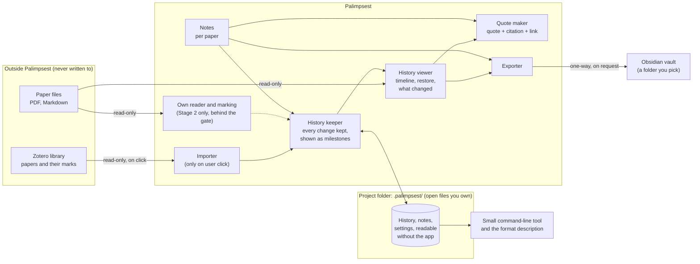

# Round 4: High-level design

Follows [03-decision-memo](03-decision-memo.md). Highest level only: parts, how a paper, marks, notes, Zotero and Obsidian fit together, and the main journeys. No technology names; those come in Round 5.

## 1. The picture



Solid lines are Stage 1. The dotted line and the reader are Stage 2.

## 2. The parts, in plain words

| Part | What it does | Stage |
|---|---|---|
| **Importer** | Reads papers, marks and their dates from Zotero when the user clicks open, import or refresh. Never watches in the background. | 1 |
| **History keeper** | The heart. Receives every change (imported mark, edited note, restore) and only ever **adds** to the record. Groups changes into milestones: automatic at import/refresh and at session end, plus named ones. | 1 |
| **History viewer** | Timeline of milestones, restore of an earlier state, plain "what changed between two milestones" list. Visual side-by-side diff comes after the gate. | 1 |
| **Notes** | One Markdown note per paper, with its own history. Links point to an exact spot in the paper. | 1 |
| **Quote maker** | Turns a mark into a quote with citation and a link back (to Zotero's page or to our reader). | 1 |
| **Exporter** | Writes notes and marks as plain Markdown into a folder the user chooses. One direction only. | 1 |
| **Open files and tool** | Everything above lives as documented, versioned files in the project folder; a small tool reads and checks them without the app. "Unstable v0." | 1 |
| **Own reader and marking** | Read PDF and Markdown inside Palimpsest and make marks that go straight to the history keeper. | 2 |
| **Forget control** | One click, with confirmation, erases one paper's history. The app itself never rewrites history silently. | 1 |

## 3. How the pieces fit together

- **The paper** stays where it is. Palimpsest never changes it and never copies it.
- **Marks** have one of two origins. *Imported from Zotero*: read-only copies that show where they came from; there is no write-back. *Made here* (Stage 2): ours.
- **Notes** are ours, written in Palimpsest, one per paper, each edit kept.
- **History** is one record per paper, inside the project folder. Everything the user sees (timeline, restore, changed list, quotes, exports) is derived from it. If the app disappears, the record stays readable.
- **Zotero** is a source we read from, only when asked. **Obsidian** is a destination we write to, only when asked, only into a folder the user confirmed. Neither is ever changed in place.
- **The same record on two machines** (through whatever sync tool the user already has) must combine without loss. This is the biggest open design question for Round 5.

## 4. Main user journeys

1. **First use (Stage 1).** Switch Zotero's local access on (guided) → pick a paper → import → its marks appear as the first milestone. *Done in minutes, nothing to set up beyond that.*
2. **Come back after months.** Open the paper → refresh from Zotero (new milestone) → open the timeline → see "what changed since March" → restore a mark that was deleted by mistake.
3. **Write and quote.** Select a mark → "quote with citation" → lands in the paper's note with a link back; later export notes to the vault folder → open them in Obsidian.
4. **Name a moment.** "Before rebuttal" → a named milestone, easy to find and compare later.
5. **Confidential review.** Work on a paper → press "forget this paper's history" → confirm → gone, with the paper untouched.
6. **Mark inside Palimpsest (Stage 2).** Open a PDF or Markdown file in our own reader → highlight → the mark enters the same history as any other.

## 5. Stages and the gate

```
Stage 0  validate (interviews, mock-up, Zotero check)
Stage 1  importer + history keeper/viewer + notes + quote + export + open files
         ── GATE: do people open the history unprompted? does the Zotero/Obsidian loop stick? ──
Stage 2  own reader and marking (PDF, Markdown)
```

Design rule that makes the staging safe: **the history keeper does not care where a mark came from.** Stage 2 adds a new source of marks, not a new core.

## 6. Things Round 5 must settle (not decided here)

1. Can we read marks, their dates and the paper's location from Zotero reliably? (One-day check first.)
2. How to keep a mark attached to the right text when the file differs slightly between copies or versions.
3. How two machines' records combine without loss.
4. Delivery as a stand-alone app versus a plug-in, and what each costs a small team.
5. How the reader (Stage 2) reuses the Stage 1 core instead of rewriting it.
