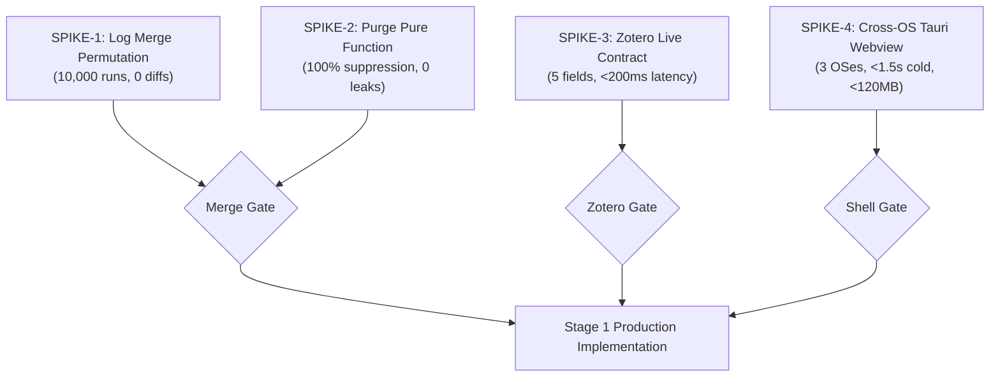

# QA Delta Review: ARCHITECTURE.md v2.0 and ADRs 0006–0012

**Author:** QA (`agent-1793867530011-poqhdm`)  
**Target:** [`docs/ARCHITECTURE.md`](../ARCHITECTURE.md) (v2.0), [`docs/adr/0006-0012`](../adr/), [`docs/debate/07-tech-decision-memo.md`](../debate/07-tech-decision-memo.md)  
**Status:** Findings & Testability Delta · **Scope:** Staged MVP (Stage 1 / Stage 2)

---

## 1. Disposition of Round-6 QA Objections

| # | Round-6 Objection | Architectural Resolution in v2.0 | Disposition | Rationale & Testability Assessment |
|---|---|---|---|---|
| **1** | **Erase marker file violates immutability & is untestable across sync** ([06-qa §1](debate/06-qa.md)) | Dropped separate `.erased` marker file. "Forget" deletes local files on initiating device, appends contentless `purge` event to this device's log. Read filter ignores events with `hlc <= purge.hlc`. Remote machines prompt before deleting local files ([ADR 0007 §28](../adr/0007-per-device-history-log-merge-and-forget.md); [Memo 07 §1](../debate/07-tech-decision-memo.md)). | **Partly Resolved** | **Resolved:** Read-side filtering is now a deterministic pure function (`hlc <= purge.hlc`). Local deletion is honest without shredder illusions. **Unresolved:** The cross-device prompt on peer devices ("history was erased on another device; delete the hidden files here?") introduces unspecified interactive state machine behavior (prompt persistence, rejection handling, and potential event resurrection if peer clock is skewed). |
| **2** | **Deferring Tauri/PDF.js validation to Stage 2 risks massive rewrite** ([06-qa §2](debate/06-qa.md)) | Accepted in full. Mandated a **Week-1 web-view spike** rendering a 50 MB PDF via PDF.js across WebKitGTK, WebView2, and WKWebView before Stage 1 production coding commences ([ADR 0006 §15](../adr/0006-staged-mvp-and-delivery-shape.md); [ARCHITECTURE §2.4, §5, §7.2](../ARCHITECTURE.md); [Memo 07 §1 row 4](../debate/07-tech-decision-memo.md)). | **Resolved** | Clear, uncompromised go/no-go gate prior to committing frontend architectural effort. Eliminates framework flip risk early. |
| **3** | **Zotero integration untestable in CI without stand-in** ([06-qa §3](debate/06-qa.md)) | Accepted in full. Contract-first architecture: recorded real API answers from a dummy library stored in `tests/fixtures/zotero/` served by a local stand-in mock server during CI. Dropped raw SQLite fallback ([ADR 0009 §19](../adr/0009-zotero-integration.md); [ARCHITECTURE §5](../ARCHITECTURE.md); [Memo 07 §1 row 5](../debate/07-tech-decision-memo.md)). | **Resolved** | Decouples automated CI test suite from live desktop dependencies. Guarantees deterministic, fast regression runs for broker parsers. |

---

## 2. New Untestable or Unspecified Behaviors in v2.0

### 2.1 Purge Rule & Asynchronous Peer Notification
* **Citation:** [ADR 0007 §28](../adr/0007-per-device-history-log-merge-and-forget.md); [ARCHITECTURE §2.3](../ARCHITECTURE.md) ("Forget a paper").
* **Gaps:**
  1. *Prompt State Lifecycle:* When Machine B reads a `purge` event originating from Machine A, how is the user's answer recorded? If the user declines ("Keep files"), does the prompt re-appear on every app launch? If the user accepts, are peer files erased or just local cache?
  2. *Clock-Skew Resurrection:* If Machine B generated annotations offline before the purge occurred, but Machine B's clock was drifted ahead such that `event.hlc > purge.hlc`, the merge union will resurrect those pre-purge edits because filtering evaluates `hlc <= purge.hlc` strictly.
  3. *Post-Purge Re-annotation:* Does `purge` permanently seal a `<paper-id>`, or can subsequent events with `hlc > purge.hlc` legally establish a fresh session? If re-annotated, how does the UI disambiguate between resurrected skew events and intentional new notes?

### 2.2 Device-ID Drift & Collision Detection
* **Citation:** [ADR 0007 §24](../adr/0007-per-device-history-log-merge-and-forget.md); [ARCHITECTURE §3](../ARCHITECTURE.md).
* **Gap:** ADR 0007 states: *"If our file changed in a way we did not write (cloned machine, restored backup) we pick a new id."* The detection mechanism is unspecified. A device cannot know its file was externally modified unless the core tracks `last_written_seq` and expected byte offset in local app storage (`~/.config/palimpsest/`). Without an explicit state schema, test harnesses cannot inject or verify collision detection, risking infinite ID regeneration loops or silent file clobbering.

### 2.3 Log Quarantine vs. File Immutability
* **Citation:** [ADR 0007 §29](../adr/0007-per-device-history-log-merge-and-forget.md); [ARCHITECTURE §2.3](../ARCHITECTURE.md) ("Open a paper"), [§4 SEC-10, SEC-13](../ARCHITECTURE.md).
* **Gap:** ADR 0007 specifies quarantining torn lines and events with `hlc > now + 24 h` into `.palimpsest/corrupt/`. Does quarantine modify `<device-id>.jsonl` by truncating/excising the offending lines? If it rewrites `<device-id>.jsonl`, it breaks append-only guarantees and causes sync conflicts in Git/Dropbox. If it does not rewrite the file, the parser will re-quarantine the same lines on every subsequent open. The spec must define quarantine as an append-only pointer/tombstone log in `.palimpsest/corrupt/` while leaving source `.jsonl` files byte-immutable.

### 2.4 Notify-Only Update Manifest Contract
* **Citation:** [ADR 0012 §15](../adr/0012-distribution-updates-and-network-rule.md); [ARCHITECTURE §2.2, §4 SEC-28](../ARCHITECTURE.md).
* **Gap:** The update check fetches a static JSON manifest over HTTPS. The schema (`version`, `release_date`, `min_supported_version`, `notes`), maximum response payload size limit, network timeout (must be hard-capped at ≤ 5 s), and downgrade handling (server version < installed version) are omitted. Automated component testing requires explicit error contracts for 404, 500, TLS failure, and corrupt JSON.

### 2.5 External `note.md` Conflict Resolution
* **Citation:** [ADR 0008 §17](../adr/0008-notes-and-obsidian-export.md); [ARCHITECTURE §2.3](../ARCHITECTURE.md).
* **Gap:** On open, `note.md` is compared with the last recorded `note_revision`. If different, an "edited outside" revision is appended. If Palimpsest has unpersisted in-memory edits when external disk changes occur, the merge rule is undefined: does disk win, does memory win, or does it fork? The revision payload format (full text snapshot vs diff) must also be pinned.

---

## 3. Mandatory Pre-Implementation Spikes & Quality Gates

Before any Stage 1 production coding begins, the following four verification spikes must execute and pass against quantified thresholds:

### SPIKE-1: Multi-Device Log Merge Permutation & Idempotency
* **Test Harness:** Property-based testing (`proptest`) generating synthetic event logs across 5 concurrent virtual devices with arbitrary interleaving, line splits, and duplicate deliveries.
* **Pass / Fail Thresholds:**
  * **Pass:** `merge(A, B) == merge(B, A)` (Commutative) in **10,000 / 10,000** iterations (100%).
  * **Pass:** `merge(merge(A, B), B) == merge(A, B)` (Idempotent) in **10,000 / 10,000** iterations (100%).
  * **Pass:** Replay throughput: 10,000 events folded into state in **< 500 ms** (well within §2.4 budget of < 1.0 s).
  * **Fail:** Any divergence in materialized state across permutations.

### SPIKE-2: Purge Rule Pure Function & Clock Skew Resilience
* **Test Harness:** Unit suite testing `filter_purged(Timeline, Vec<PurgeEvent>) -> TimelineState` against skewed HLC stamps and multiple chronological purges.
* **Pass / Fail Thresholds:**
  * **Pass:** **100%** of events with `hlc <= purge.hlc` excluded from the active timeline view.
  * **Pass:** Purge monotonicity: later purge `hlc_2 > hlc_1` supersedes earlier purge; older purge arriving late cannot resurrect previously purged data.
  * **Pass:** Legitimate new events created post-purge (`hlc > purge.hlc`) are retained with 100% integrity.
  * **Fail:** Any payload leakage of purged events into export or timeline projection.

### SPIKE-3: Zotero Local Broker Contract Verification
* **Test Harness:** (a) CI mock server (`wiremock-rs`) replaying `tests/fixtures/zotero/`; (b) One-day live probe script against real Zotero 7 on `127.0.0.1:23119`.
* **Pass / Fail Thresholds:**
  * **Pass (CI Mock):** 100% pass across 15 recorded fixture scenarios (including pagination > 100 items, empty libraries, malformed payloads, HTTP 404/500).
  * **Pass (Live Contract Gate):** Real Zotero local API returns: (1) item metadata, (2) child annotations, (3) annotation text and color, (4) bounding boxes / rects, (5) modification timestamps. Latency **< 200 ms** for 100 items.
  * **Fail:** If live API lacks bounding boxes or modification timestamps, trigger Decision for the User #4 ([07-memo §3](../debate/07-tech-decision-memo.md)) immediately.

### SPIKE-4: Cross-OS Tauri Webview & PDF.js Rendering Spike
* **Test Harness:** Minimal Tauri v2 window loading PDF.js and rendering a complex 50 MB / 500-page benchmark PDF in CI across Ubuntu (WebKitGTK), Windows 10/11 (WebView2), and macOS 12+ (WKWebView).
* **Pass / Fail Thresholds:**
  * **Pass:** Cold first-page render time **< 1.5 s** across all 3 platforms (hard ceiling 2.0 s per §2.4).
  * **Pass:** Text layer selection accuracy: 100% match on known fixture strings; bounding rect extraction within **< 50 ms** of drag release.
  * **Pass:** Idle memory footprint **< 120 MB** RSS after 10 page navigations.
  * **Fail:** WebKitGTK canvas crashes, blank pages, or text-layer offset misalignments on any OS.

---

## 4. Ranked Blockers and Recommendations

### Tier 1: Critical Blockers (Must resolve before Stage 1 coding starts)
1. **[BLOCKER-1] Define Device-ID Collision Detection State Machine:**
   * *Risk:* Without pinning how the core detects external writes to `<device-id>.jsonl`, synced machines may clobber logs or enter infinite UUID regeneration loops.
   * *Resolution:* Mandate local tracker in per-user storage (`device_state.json`) recording `{ device_id, papers: { [paper_id]: { last_seq: u64, file_size: u64 } } }`. If file on disk has size > recorded size but last line `seq` != `last_seq + 1`, declare external modification and mint fresh UUID.
2. **[BLOCKER-2] Clarify Non-Destructive Log Quarantine Protocol:**
   * *Risk:* Excising corrupt or clock-skewed lines from `<device-id>.jsonl` mutates synced files, causing Git conflicts.
   * *Resolution:* Specify that `<device-id>.jsonl` is strictly immutable. Quarantine copies the bad line into `.palimpsest/corrupt/<device>-quarantine.log` with file offset and error reason; memory parser simply skips invalid offsets without rewriting disk files.
3. **[BLOCKER-3] Execute Live Zotero Contract Gate (SPIKE-3):**
   * *Risk:* Writing Stage 1 import core against presumed API endpoints before verifying real Zotero 7 annotation schemas risks complete rewrite.
   * *Resolution:* Execute SPIKE-3 Day 1. If undocumented endpoints do not provide mark coordinates, halt and prompt user per Decision #4.

### Tier 2: Nice-to-Haves (Can be resolved during Stage 1 sprint)
4. **[NTH-1] Update Check Schema & Timeout Pinning ([ADR 0012](../adr/0012-distribution-updates-and-network-rule.md)):** Pin static JSON schema with SemVer regex, max payload 10 KB, hard 5 s timeout.
5. **[NTH-2] External `note.md` Snapshot Strategy ([ADR 0008](../adr/0008-notes-and-obsidian-export.md)):** Store full markdown text snapshot in `note_revision` on outside edit detection rather than diffs to simplify recovery.
6. **[NTH-3] Peer Purge Prompt Persistence ([ADR 0007](../adr/0007-per-device-history-log-merge-and-forget.md)):** Store peer purge prompt dismissal in local app storage so users are not prompted repeatedly.
